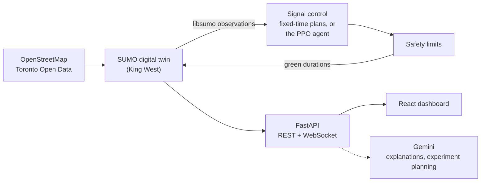

# FlowState

A digital twin of downtown Toronto for traffic-signal control: a simulator that runs real street geometry, a reinforcement learning
agent that learns from it, and a dashboard that shows the agent against fixed-time signals on identical traffic.

FlowState runs [Eclipse SUMO](https://eclipse.dev/sumo/) behind a FastAPI server and draws what SUMO is doing in the browser: real
street geometry, every car, cyclist and pedestrian, signal heads, collisions, ambulances. You pick a scenario (a rush hour, a crash on
Queen Street, a stadium letting out), press run, and watch it happen. Every run comes from a seed, so the same seed reproduces the
same traffic, and two controllers can be handed the exact same vehicles and measured against each other.

https://github.com/user-attachments/assets/a3295227-1e2b-4704-8689-3e6d3d79ece8


*Road Accident, seed 7, at 16x. A collision closes John Street northbound, a police unit is on its way, and the queue is backing up
into the next junctions.*

## The pipeline



1. **Real-world data.** Road geometry comes from OpenStreetMap: the street lines, classes, one-way pairs and names of King West
   (Front St to Queen St, Peter St to Simcoe St). Toronto Open Data supplies the traffic-count context used to model demand.
   Together they make the Toronto digital twin. Both map extracts are committed, so a network build works offline.
2. **Traffic simulation.** SUMO simulates the vehicles, intersections, congestion, accidents and signal behaviour. The Python backend
   uses libsumo, SUMO's in-process binding, to observe every vehicle and to set signal timings programmatically.
3. **Reinforcement learning.** One PPO agent controls all 22 King West signals. Every 5 seconds each junction gets its own
   observation (queues, waiting, downstream occupancy, time in green) and the shared network picks hold, end or extend for its
   green. It is trained in PyTorch on SUMO episodes of five scenarios, with halting vehicles as the cost, and selected on separate
   validation seeds.
4. **Safety limits.** The agent only changes how long a green lasts. Amber, all-red, pedestrian clearance and protected-left
   phases always run their programmed length and the phase order is the plan's. A green cannot end before its minimum (8 to 12 s
   by intersection type) or be extended past 60 s, and no combination with transit or ambulance priority holds one past 80 s.
   The agent can only choose among timings these limits allow.
5. **Gemini.** Google's Gemini API powers the plain-language layer: it explains congestion patterns, interprets results and helps
   plan experiments. It never touches the signals. Its answers are checked against the measured simulation numbers, and there
   is an offline fallback when no key is available.
6. **Backend.** The FastAPI service and the SUMO engine run on a Vultr server in Toronto and expose REST endpoints and a WebSocket, so
   simulations run remotely and stream traffic to the browser in real time.
7. **Frontend.** The React dashboard is hosted on Vercel at flowstate.nyc. It shows the Toronto network, moving vehicles, signal
   states, congestion metrics and the before/after comparison.
8. **Evaluation.** Fixed-time signals and the agent are run in SUMO on identical demand, on seeds the agent never trained on. We
   measure waiting time, time lost, queue length, throughput, trips not served and safety outcomes (collisions and teleports).

### Where each stage lives

| Stage | Code |
|---|---|
| Network, simulation engine, scenarios, API | `backend/flowstate/{network,sim,scenarios,api}` |
| The agent: observation, policy, training, evaluation, publication gate | `backend/flowstate/ml` |
| Recorded side-by-side replays, ambulance green priority | `backend/flowstate/replay` |
| Trained model and its held-out evaluation | `artifacts/ml` |
| Dashboard and Results tab | `frontend/src` |

## Results

Fixed-time signals against the agent on identical traffic, on the King West network: 80 held-out seeds across six scenarios
(480 paired runs). One scenario, the stadium event, was never used for training or selection.

| | Fixed-time | ML agent | Change |
|---|---:|---:|---:|
| Mean wait per vehicle | 52.0 s | 38.3 s | -26.3 % |
| Time lost per vehicle | 95.8 s | 81.4 s | -15.0 % |
| Peak queue | 50 veh | 41 veh | -16.8 % |
| Throughput | 1,345 veh/h | 1,444 veh/h | +7.4 % |

These are simulation results. Demand is a seeded model, not calibrated to Toronto traffic counts
(`docs/TORONTO_DEMAND_STRATEGY.md`). The agent is published only while it passes a gate on those held-out runs: waiting must be
clearly lower than fixed-time, and time lost, throughput, teleports and trips not served must not be worse, overall and in every
scenario (`backend/flowstate/ml/evaluate.py`). The Results tab in the app shows every run and replays scenarios side by side.

## In the app

- 11 scenarios, listed below, each with parameters you can set or leave to the seed.
- Follow a single vehicle, click a junction to see its phase and queues, click an event to jump to it.
- Pause, change speed (0.5x to 16x), restart with the same seed, or draw a new variation.
- A **controlled comparison** runs two headless SUMO runs on the same seed that differ in one setting: signal control, weather, King
  Street design and so on.


*Analytics for a finished run: speed, delay, throughput, queues and trips by mode.*

| Scenario | What the seed draws | What is measured |
|---|---|---|
| Rush Hour | peak intensity, timing, origin-destination imbalance | delay, queues, throughput |
| Road Accident | location, severity, lanes closed, time, clearance, responder delay | queue behind the scene, detours, responder arrival |
| Ambulance Dispatch | call times and scenes | response time against free flow, pre-emptions |
| Police Pursuit | origin, evasive re-targeting, unit dispatch | time to stop, closest approach |
| Bike Lane Conversion | demand (network chosen by parameter) | cyclist speed, car travel time, corridor speeds |
| Construction | location, lane or full closure | merge queue, detour |
| Stadium Event | attendance, surge timing | venue queues, network delay |
| School Dismissal | bell time, pick-up arrivals | frontage queues, pedestrian volumes |
| Transit Priority | departures with headway jitter, boardings | bus travel time, timetable delay, green extensions |
| Severe Weather | condition and severity | speed and delay against clear weather (via a comparison) |
| Random Urban Disruption | two to four non-overlapping disruptions | network delay, response |

## How the simulation works

- **SUMO owns the traffic.** Positions, headings, brake lights, signal states and the metrics all come from SUMO. The frontend only
  interpolates between real simulation steps (cubic Hermite, using SUMO's heading and speed) and never extrapolates.
- **Seeds make runs reproducible.** A scenario is built from reusable components, and the seed draws a concrete instance, for example
  "severe collision, all lanes closed on Church St southbound, 03:40 to 21:29". The same seed with the same settings gives the same
  SUMO trajectories, and there is a test for it.
- **Drivers.** IDM car following and the SL2015 lane-change model in SUMO's sublane mode, with per-run driver profiles drawn from
  the seed. Emergency vehicles use SUMO's bluelight device, so other drivers react to them.
- **Measurements.** Waiting time, travel time, throughput, queues, teleports and collisions are counted from SUMO, never estimated.

## Running it

You need Python 3.10+ and Node 18+. SUMO comes from PyPI (`eclipse-sumo`, `libsumo`), so there is nothing else to install.

```bash
./run.sh          # macOS / Linux
.\run.ps1         # Windows
```

The script creates a virtualenv, installs the backend, builds the SUMO networks if they are missing, and starts the API on port 8000
and the UI on port 5173. Open <http://127.0.0.1:5173>.

To start the pieces by hand:

```bash
python -m venv .venv && source .venv/bin/activate        # Windows: .venv\Scripts\activate
pip install -r backend/requirements.txt
cd backend && python -m flowstate.cli build-network      # once
python -m flowstate.cli serve --port 8000                # terminal 1
cd frontend && npm install && npm run dev                # terminal 2
```

The CLI also runs a scenario without the UI and prints the results as JSON:
`python -m flowstate.cli run --scenario rush_hour --seed 42`.

Keyboard: `Space` play/pause, `R` restart with the same seed, `N` new variation, `F` fit the network, `H` default view, `\` hide the
side panels, `+`/`-` zoom.

## Tests

```bash
python -m pytest tests -q                 # 177 tests: API, WebSocket, network, scenarios, real SUMO runs
cd frontend && npm test && npm run build  # 43 unit tests, then a type-checked production build
```

The Python suite includes real SUMO runs (scenario placement, closures, responders, reproducibility), so the full run takes about
nine minutes.

## Repository layout

```
backend/flowstate/
  network/    street network: OSM import (toronto.py), cross-sections and signals (city.py), render geometry
  sim/        SUMO engine loop, demand, signals, driver models, metrics, safety observations
  scenarios/  scenario framework and the 11-scenario catalog
  api/        REST + WebSocket server and the live run service
  performance/  benchmark and audit tooling (congestion presets, resource measurement)
frontend/src/
  map/        Canvas 2D renderer: road scene, vehicle sprites, camera, overlays
  views/      Analytics, Run history, Results
  components/ rails, panels, run bar     lib/  state store, WebSocket client, frame playout
data/         committed networks and OpenStreetMap extracts
tests/        pytest suite          tools/  congestion audits, OSM fetch          docs/  deployment, performance and audit notes
```

## Built with

Python, FastAPI, Eclipse SUMO 1.28 (libsumo, netconvert, sumolib), Stable-Baselines3, Gymnasium, PPO, scikit-learn (gradient-boosted
regressors), Google Gemini, React 19, TypeScript, Vite, Tailwind, Radix UI, Zustand, Recharts, Canvas 2D, pytest, Vitest, Vultr,
Vercel.

Map data is © [OpenStreetMap contributors](https://www.openstreetmap.org/copyright) (ODbL). Traffic counts come from the City of
Toronto's [open data](https://open.toronto.ca/open-data-licence/).
